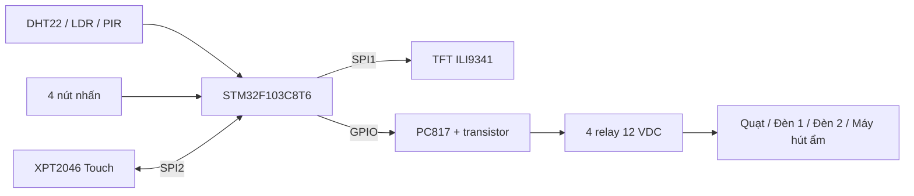
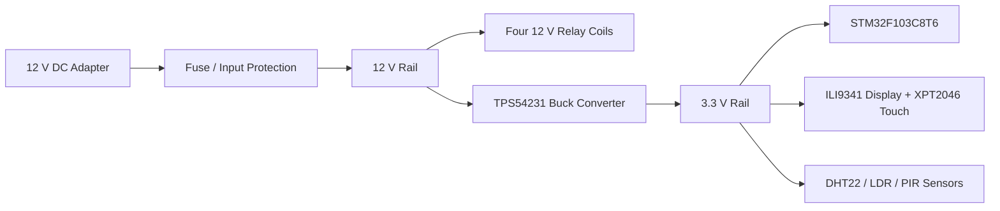

# Auto Switch – Hệ thống giám sát và điều khiển thiết bị phòng

**STM32F103C8T6 | DHT22 · LDR · PIR | ILI9341 + XPT2046 | 4 relay**

[Thiết kế KiCad](Hardware/01_Design) · [Schematic PDF](Hardware/02_Schematic_PDF/Smart_Switch.pdf) · [BOM](Hardware/03_Bom) · [Gerber](Hardware/04_Gerber) · [Firmware – branch ILI9341](https://github.com/VuLinh011218/Auto_Switch/tree/ILI9341/Firmware)

## 1. Giới thiệu

Auto Switch là mạch giám sát các điều kiện trong phòng và điều khiển **quạt, hai đèn và máy hút ẩm**. STM32F103C8T6 đọc dữ liệu từ cảm biến nhiệt độ – độ ẩm, ánh sáng và chuyển động; trạng thái hệ thống được đưa lên màn hình TFT 2.8 inch. Người dùng thao tác bằng cảm ứng hoặc nút nhấn vật lý.

Hệ thống được thiết kế với hai chế độ:

- **Manual:** Người dùng bật/tắt từng thiết bị.
- **Auto:** Vi điều khiển điều khiển thiết bị theo dữ liệu cảm biến và ngưỡng đã đặt.

## 2. Chức năng

| Chức năng | Mô tả theo thiết kế |
| --- | --- |
| Đo môi trường | DHT22 đo nhiệt độ, độ ẩm; LDR đo mức sáng; PIR AM312 phát hiện chuyển động |
| Hiển thị | TFT ILI9341 hiển thị thông số môi trường, chế độ và trạng thái bốn thiết bị |
| Điều khiển bằng tay | Bật/tắt tải bằng màn hình cảm ứng XPT2046 hoặc nút nhấn |
| Điều khiển tự động | Quạt theo nhiệt độ, máy hút ẩm theo độ ẩm, hai đèn theo ánh sáng và chuyển động |
| Đầu ra | Bốn relay điều khiển quạt, đèn 1, đèn 2 và máy hút ẩm |

### Auto Mode

- **Quạt và máy hút ẩm:** đóng/ngắt theo các ngưỡng nhiệt độ, độ ẩm tương ứng.
- **Đèn 1 và đèn 2:** kết hợp tín hiệu PIR với hai ngưỡng ánh sáng riêng biệt. Khi trời tối hơn, đèn 2 được bật thêm; khi sáng trở lại, đèn 2 tắt trước đèn 1.
- **Thời gian giữ đèn:** mỗi lần PIR phát hiện chuyển động, bộ đếm 5 phút bắt đầu lại. Nếu không có chuyển động mới, hai đèn tắt khi hết thời gian.

## 3. Sơ đồ hệ thống

**Hình 1. Sơ đồ khối chức năng**



**Figure 2. Power Distribution**



## 4. Phần cứng

| Thành phần | Chức năng |
| --- | --- |
| STM32F103C8T6 | Vi điều khiển ARM Cortex-M3, xử lý cảm biến và lệnh điều khiển |
| DHT22 (AM2302) | Đo nhiệt độ và độ ẩm |
| LDR + LM393 | Đọc mức ánh sáng qua ngõ ra analog AO |
| PIR AM312 | Phát hiện chuyển động |
| ILI9341 2.8 inch | Màn hình TFT 240 × 320, giao tiếp SPI |
| XPT2046 | Bộ điều khiển cảm ứng, giao tiếp SPI |
| HF46F 12-HS1 (4 chiếc) | Relay điều khiển bốn tải |
| PC817 + transistor | Tầng điều khiển relay |
| TPS54231DR | Hạ áp 12 V xuống 3.3 V |
| 4 nút nhấn | Điều khiển trực tiếp tại thiết bị |

## 5. Firmware

(https://github.com/VuLinh011218/Auto_Switch/tree/ILI9341/Firmware).

```text
Firmware/
├── app/                 # Chọn chế độ, xử lý lệnh và ngưỡng điều khiển
├── middleware/
│   ├── input_mgr/       # Xử lý nút nhấn và cảm ứng
│   └── ui/              # Giao diện TFT
├── device/
│   ├── button/          # Nút nhấn, debounce
│   ├── ili9341/         # Driver màn hình
│   ├── relay/           # Điều khiển 4 relay
│   ├── sensor/          # Giao diện đọc cảm biến
│   └── xpt2046/         # Driver cảm ứng
├── Core/                # Khởi tạo MCU và ngoại vi
├── Drivers/             # STM32 HAL / CMSIS
└── Smart_Room_Control.ioc
```

## 6. Cấu trúc repository

```text
Auto_Switch/
├── Hardware/
│   ├── 01_Design/            # Project KiCad 10, schematic và PCB
│   ├── 02_Schematic_PDF/     # Bản PDF sơ đồ nguyên lý
│   ├── 03_Bom/               # Danh sách linh kiện
│   └── 04_Gerber/            # Gerber và drill files
├── Firmware/                 # Mã nguồn nằm trên branch ILI9341
└── .gitignore
```

## 7. Tài liệu dự án

- [Sơ đồ nguyên lý (PDF)](Hardware/02_Schematic_PDF/Smart_Switch.pdf)
- [Project KiCad](Hardware/01_Design/Smart_Switch.kicad_pro)
- [Thiết kế PCB](Hardware/01_Design/Smart_Switch.kicad_pcb)
- [Danh sách linh kiện (BOM)](Hardware/03_Bom/Smart_Switch.csv)
- [File Gerber](Hardware/04_Gerber)

